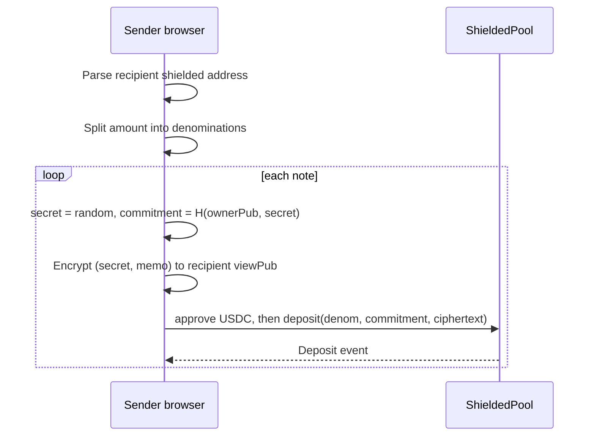
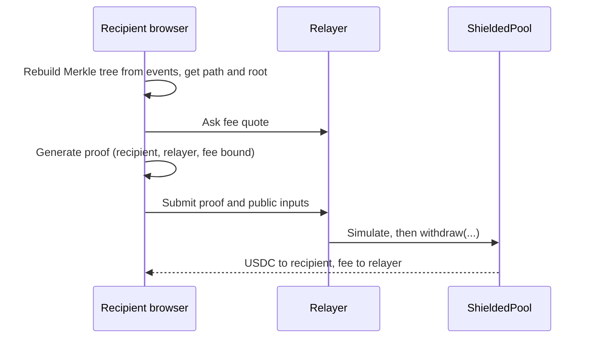

# Shielded USDC Payments on Arc Testnet: Solution Approach

Status: Draft for review
Target chain: Arc Testnet (chain ID 5042002), USDC (ERC-20 view, 6 decimals) at 0x3600000000000000000000000000000000000000
Scope: testnet only. Unaudited. Not for real funds.
Companion file: arc-studio-plans/PLAN.md (implementation plan and build sequence)

---

## 1. Problem and goal

Arc Testnet is a transparent chain. A plain USDC transfer exposes sender, recipient, amount and time. Arc's native privacy (Arc Privacy Sector) is on the roadmap and not available yet, so privacy has to be built at the contract and app level.

Goal: let a user pay another user in USDC so that an outside observer cannot tell who received the payment, and cannot tell which deposit funded which withdrawal.

Users: individuals (P2P), merchants (receive payments), businesses (payouts, with auditor access).

### Goals
- Break the public link between a payment's sender and its recipient.
- Standardize amounts so a payment cannot be identified by its size.
- Let the recipient withdraw without already holding gas (gas on Arc is USDC).
- Let a user selectively disclose their payments to an auditor.
- Keep the privacy layer behind a small interface so Arc native privacy can replace it later.

### Non-goals
- Fully hidden arbitrary amounts (needs a UTXO join-split circuit; out of scope for v1).
- Hiding the sender's deposit or the recipient's withdrawal as events (they are public by nature).
- Network-level anonymity (IP addresses, RPC provider logs).
- Mainnet deployment, production-grade trusted setup, formal audit.
- Compliance screening or sanctions tooling.

---

## 2. Options considered

| Option | Hides | Trust | Why not chosen as the core |
|---|---|---|---|
| Off-chain ledger / custodial relay | Amount and recipient from public | Operator sees and controls everything | Not real onchain privacy |
| Stealth addresses (ERC-5564 style) | Recipient identity | None for privacy | Amounts stay public; new addresses need gas, which links back to a funder |
| Shielded pool with zero-knowledge proofs (chosen) | Sender-to-recipient link; amounts standardized | Contract and circuit correctness; dev-only setup on testnet | Anonymity depends on pool size |
| Wait for Arc Privacy Sector | Native confidentiality with view keys | Arc validators and enclaves | Not available; no date published |
| Route through Zcash or Monero (Husher-style) | Link between source and destination | Third-party swap providers | Leaves Arc, 5+ minutes, about 1% fee, adds counterparties |

Decision: shielded pool with fixed denominations, plus recipient-bound notes and an encrypted note-delivery layer.

---

## 3. System overview

### Components
1. ShieldedPool contract: holds USDC, keeps one Merkle tree of note commitments per denomination, tracks spent nullifiers, verifies proofs.
2. Verifier contract: generated Groth16 verifier for the withdraw circuit.
3. Withdraw circuit (circom): proves "I own a note in the tree" and binds the payout details.
4. Client library: key derivation, note creation and encryption, event scanning, Merkle path building, in-browser proving.
5. Relayer: server route that submits withdrawals and is paid a fee in USDC.
6. Web app: send, inbox, withdraw, disclosure, privacy meter.

### Actors and trust

| Actor | Trust level | Can do | Cannot do |
|---|---|---|---|
| Sender | Untrusted | Deposit into the pool for a recipient's shielded address | Spend the note after sending (does not know the spend key) |
| Recipient | Untrusted | Scan for notes, withdraw with a proof | Spend notes that are not theirs |
| Relayer | Semi-trusted | Submit withdrawals, earn the fee, censor requests | Change recipient or fee (they are proof inputs), steal funds |
| Auditor | Semi-trusted | Read what the user shares through a viewing key | Spend, or see anything not shared |
| Pool owner | Semi-trusted | Pause deposits | Move funds, block withdrawals, change denominations |
| Public observer | Untrusted | See deposits, withdrawals, pool sizes | Link a deposit to a withdrawal (beyond statistical guesses) |

---

## 4. Cryptographic design

### 4.1 Primitives
- Curve and proof system: Groth16 on BN254 (alt_bn128). Needs the BN254 precompiles (addresses 0x06, 0x07, 0x08) on Arc Testnet. This is verified in the first build step.
- Hash: Poseidon (circomlib-compatible parameters). Same hash in circuit, browser and Solidity.
- Tree: incremental Merkle tree, depth 20 per denomination (about one million notes each).
- Note encryption: ECIES with X25519 key agreement and ChaCha20-Poly1305.

### 4.2 Keys
Each user derives, from one wallet signature over a fixed message, three values:
- spendKey (ownerPriv): a field element. Never leaves the browser. Needed to withdraw.
- ownerPub = Poseidon(ownerPriv). Public part of the shielded address.
- viewKey: an X25519 private key. Lets its holder decrypt incoming notes, but not spend.

Shielded address = (ownerPub, viewPub), encoded as one shareable string.

Keys are deterministic from the wallet signature, so the user can recover them with the same wallet. They are held in memory only and never sent to a server.

### 4.3 Note (recipient-bound)
A note is created by the sender for a recipient's shielded address:
- secret: random field element chosen by the sender.
- commitment = Poseidon(ownerPub, secret).
- nullifierHash = Poseidon(ownerPriv, commitment).

Why recipient-bound: in plain Tornado style, whoever knows the note secret can spend it, so the sender could take the money back. Here the nullifier needs ownerPriv, which only the recipient has. The sender knows the commitment but cannot spend it and cannot detect when it is spent, so the sender cannot learn when the recipient withdraws.

### 4.4 Withdraw circuit
Private inputs: ownerPriv, secret, pathElements[20], pathIndices[20].
Public inputs: root, nullifierHash, recipient, relayer, fee.

Constraints:
1. ownerPub = Poseidon(ownerPriv)
2. commitment = Poseidon(ownerPub, secret)
3. The Merkle path from commitment hashes to root.
4. nullifierHash = Poseidon(ownerPriv, commitment)
5. Square constraints on recipient, relayer and fee so the proof is bound to them (stops a relayer or front-runner from swapping them).

Size: roughly 10,000 constraints, so a small powers-of-tau file is enough. Proving in a browser takes seconds on a typical laptop (to be measured during the build).

### 4.5 Note delivery
The sender encrypts (denomination, secret, optional memo, leafIndex hint) to the recipient's viewPub and emits it in the Deposit event. The recipient scans events and trial-decrypts each ciphertext. A copy encrypted to the sender's own viewPub lets the sender see their sent history.

The memo is encrypted and capped in size. It is never stored in plaintext.

### 4.6 Trusted setup
Groth16 needs a setup ceremony. For testnet the build uses a downloaded public powers-of-tau file plus a single local phase-2 contribution. The UI and docs label this "development setup, not secure". A production deployment would need a multi-party ceremony or a switch to a transparent proof system.

---

## 5. Contract design (ShieldedPool)

### 5.1 Language and toolchain
Solidity 0.8.28, Cancun EVM, Foundry (matches the project's foundry.toml). OpenZeppelin 5.6.1 for SafeERC20, Ownable2Step, ReentrancyGuard and Pausable. Poseidon hashing via a circomlib-compatible Solidity library (poseidon-solidity), deployed as a library or separate contract.

### 5.2 State
- IERC20 immutable usdc.
- IVerifier immutable verifier.
- uint256[] immutable denominations (for example 100000, 1000000, 10000000 in 6-decimal units).
- Per denomination: filledSubtrees[20], current root index, roots ring buffer (last 30 roots), next leaf index.
- mapping(bytes32 nullifierHash => bool) spent.
- mapping(bytes32 commitment => bool) seen (rejects duplicate commitments).
- Pausable state (deposits only).

### 5.3 Functions (write)

| Function | Caller | Effects | Reverts when |
|---|---|---|---|
| deposit(denomIndex, commitment, ephemeralPub, ciphertext) | Anyone | Pulls exactly the denomination in USDC, inserts commitment, emits Deposit | Paused; bad index; commitment seen or not in field; balance delta not equal to denomination; tree full; ciphertext too large |
| withdraw(denomIndex, proof, root, nullifierHash, recipient, relayer, fee) | Anyone (usually relayer) | Verifies proof, marks nullifier spent, pays recipient and relayer | Unknown root; nullifier spent; fee greater than denomination; recipient is zero address; proof invalid |
| pause / unpause | Owner | Toggles deposits only | Not owner |
| transferOwnership / acceptOwnership | Owner / pending | Two-step handover | Not owner / not pending |

Withdraw ordering: checks, then mark nullifier spent, then transfer (checks-effects-interactions) with nonReentrant on both entry points.

### 5.4 Functions (read)
getLastRoot(denomIndex), isKnownRoot(denomIndex, root), isSpent(nullifierHash), denominations(), nextLeafIndex(denomIndex).

### 5.5 Events
- Deposit(uint8 denomIndex, bytes32 commitment, uint32 leafIndex, uint256 timestamp, bytes32 ephemeralPub, bytes ciphertext)
- Withdrawal(uint8 denomIndex, address recipient, bytes32 nullifierHash, address relayer, uint256 fee)

### 5.6 Roles and admin surface
Deliberately small:
- Owner (Ownable2Step, no renounce): pause and unpause deposits.
- No role can change denominations, verifier, token, or touch funds.
- Withdrawals can never be paused, so funds are never trapped.

### 5.7 Upgradeability
None. The contract is immutable. Migration means deploying a new pool and letting users withdraw from the old one. Simpler to review and removes an upgrade-key risk.

### 5.8 Flow of funds and invariants

| Step | Movement | Invariant |
|---|---|---|
| Deposit | Sender to pool, exactly one denomination | Pool USDC balance rises by exactly the denomination, one leaf added |
| Withdraw | Pool to recipient (denomination minus fee) and relayer (fee) | One nullifier is spent, total paid equals one denomination |
| At rest | Pool holds USDC | Pool balance equals (unspent notes) times their denominations |

---

## 6. Application flows

### 6.1 Deposit (send privately)

The split preview shows exactly which notes will be created. If the amount cannot be made from allowed denominations, the UI says so and suggests the nearest valid amount.

### 6.2 Receive (inbox)
Recipient connects, derives keys, scans Deposit events from the pool's deployment block, trial-decrypts, and lists notes. Spent status is computed by checking each note's nullifierHash against the contract.

### 6.3 Withdraw

Fallback if the relayer is down: the recipient can submit the withdrawal from their own address with zero fee, at the cost of needing gas and weaker privacy. The UI warns about this.

### 6.4 Disclosure for auditors
Two levels:
1. Viewing key export: gives read access to all incoming notes. Cannot spend. Revocation is not possible once shared, so the UI warns first.
2. Payment report: a signed export of selected notes (commitment, leaf index, amount, memo, deposit transaction hash) that a third party can check against the chain.

---

## 7. Privacy analysis

### What an observer can see
- Sender address, time and denomination of each deposit.
- Recipient address, time and denomination of each withdrawal.
- Pool size per denomination.

### What an observer cannot see (assuming no mistakes)
- Which deposit funded which withdrawal.
- The shielded address a note was sent to.
- The memo.

### Where privacy leaks
- Small pools: with few deposits, timing and amount matching can narrow the guess to one deposit.
- Immediate withdrawal: withdrawing right after a deposit weakens privacy. The UI nudges users to wait and shows the current anonymity set.
- Splitting patterns: sending 25 USDC as ten + ten + five singles can be matched by timing and by the sender. The UI suggests staggering.
- Recipient funding: if the recipient's address was funded by a known wallet, that links them. Using the relayer avoids pre-funding.
- Reusing a withdrawal address across notes links those withdrawals.
- Off-chain metadata: RPC provider, IP address, relayer logs. The relayer stores nothing beyond what it needs for rate limiting.
- USDC itself is issuer-controlled and can be blocklisted, which can make a withdrawal to a blocklisted address revert.

The privacy meter in the app surfaces these in plain language rather than promising anonymity.

---

## 8. Security considerations

| Risk | Applicable | Mitigation |
|---|---|---|
| Reentrancy | Yes (USDC transfers) | CEI ordering, nonReentrant on deposit and withdraw |
| Double spend | Yes | Spent-nullifier mapping set before payout |
| Proof malleability or front-running | Yes | recipient, relayer and fee are public inputs bound by the circuit |
| Invalid field elements | Yes | Contract rejects commitments and public inputs not less than the field size |
| Duplicate commitments | Yes | seen mapping |
| Stale or fake root | Yes | Only roots from the last 30 root history of that denomination |
| Fee-on-transfer token behavior | Low (USDC) | Balance-delta check on deposit |
| Access control | Yes | One small owner role, two-step transfer, no renounce |
| Denial of service | Yes | No loops over user data; tree insert cost is fixed (20 hashes) |
| Relayer abuse | Yes | Rate limiting, simulation before send, fee cap, relayer key kept in server environment only |
| Weak trusted setup | Yes | Labeled dev-only; testnet only |
| Circuit bugs (under-constrained) | Yes | Constraint review, negative test vectors, independent review before any real use |
| Centralization | Low | Owner can only pause deposits |
| Approval persistence | Yes | Frontend approves the exact amount needed |
| Timestamp dependence | Low | Timestamp is only emitted, not used in logic |

Threat model per privileged actor:

| Actor | Worst case if compromised | Mitigation | Detection |
|---|---|---|---|
| Owner key | Pause deposits indefinitely | Withdrawals unaffected; migrate to a new pool | Pause event alert |
| Relayer key | Spend relayer's own USDC; refuse or delay service | Relayer holds only a small gas float; direct withdraw fallback | Balance and error monitoring |
| Viewing key leak | Reader learns incoming payments | Cannot spend; rotate to a new shielded address | User-initiated |
| Spend key leak | Attacker withdraws that user's notes | Keys never leave the browser; derived on demand | None possible, so UI stresses wallet safety |

Secrets: the relayer private key lives only in server environment variables. It is never committed, logged, or exposed to the browser.

---

## 9. Failure scenarios

- Deposit transaction succeeds but note encryption data is lost: the note is still spendable only by the recipient, who finds it by scanning; the sender's encrypted copy restores sender history.
- Browser closes during proof generation: nothing is on-chain yet; the user retries.
- Relayer submits but the transaction reverts: no state changes, nullifier stays unspent; the user can retry or withdraw directly.
- Root history rolls over before submission: the client rebuilds the proof against a fresh root and retries.
- Recipient is USDC-blocklisted: withdraw reverts atomically; the user picks another address.
- Pool paused: deposits stop, withdrawals continue.
- RPC log range limits: the scanner pages through logs in chunks and caches progress locally.

---

## 10. Testing strategy

- Contract tests (Foundry): successful deposit and withdraw; double spend; wrong denomination; wrong or stale root; duplicate commitment; fee above denomination; proof bound to different recipient or relayer fails; pause behavior; ownership handover.
- Fuzz and invariant tests: pool balance always equals unspent notes times denominations; a nullifier is never spent twice; tree root matches an off-chain reference tree.
- Circuit tests: valid witness passes; tampered root, path, nullifier, recipient or fee fails; mismatch between circuit Poseidon and Solidity Poseidon is checked with fixed vectors.
- Client tests: key derivation is deterministic; encrypt then decrypt round trip; denomination splitting sums correctly; Merkle tree matches the contract root.
- End-to-end on Arc Testnet: two wallets, one relayer, funded from the faucet, covering send, scan, withdraw, and a disclosure export.
- Static analysis on the contracts and a manual review of the circuit before the demo.
- Gates: typecheck, lint and contract tests must pass.

---

## 11. Third-party components

| Component | Purpose | Notes |
|---|---|---|
| OpenZeppelin Contracts 5.6.1 | SafeERC20, Ownable2Step, Pausable, ReentrancyGuard | Already a dependency; widely reviewed |
| circom and circomlib | Circuit and Poseidon | Needs the compiler available in the sandbox (first build check) |
| snarkjs | Setup, proving, verifier generation | Browser proving with WASM |
| poseidon-solidity | On-chain Poseidon | Must match circomlib parameters |
| noble curves and ciphers | X25519 and ChaCha20-Poly1305 | Audited, small, browser-friendly |
| viem, wagmi, ConnectKit | Chain access and wallet | Already in the project |

Each new dependency is version-pinned and checked for current versions during the build.

---

## 12. Monitoring and operations

- Relayer: USDC balance (alert when low), withdrawal success rate, error rate, request rate.
- Contract: Pause events, large bursts of deposits or withdrawals, nullifier reuse attempts (reverted transactions).
- App: pool size per denomination (shown to users), last scanned block.
- Relayer logs avoid recipient-identifying data beyond what is needed to debug failures, with short retention.

---

## 13. Dependencies on Arc and open items

1. BN254 precompiles (ecAdd, ecMul, pairing) must be present on Arc Testnet. If they are missing, Groth16 verification cannot run and the approach has to change.
2. circom, snarkjs and a server runtime for the relayer must work in the sandbox. If there is no backend runtime, withdrawals ship without a relayer (recipient pays gas) and this limitation is shown in the UI.
3. Faucet funding: test wallets and the relayer need testnet USDC from https://faucet.circle.com.
4. Final denomination set for testnet (proposed 0.10, 1, 10 USDC) should be confirmed.
5. Log retrieval limits on the Arc Testnet RPC will determine how scanning is paged and cached.

---

## 14. Path to Arc native privacy

Keep the app behind a small interface:
- createPayment(recipientAddress, amount, memo)
- listIncoming(keys)
- withdraw(note, destination)
- exportDisclosure(selection)

The shielded pool is one implementation. When Arc Privacy Sector ships, an implementation that deploys USDC logic into the private environment can replace it with native confidentiality (including arbitrary amounts and view keys) without rewriting the UI. Details of the native feature are subject to Arc's published roadmap and may change.

---

## 15. Compliance and responsibility notes

- Testnet only. No real funds.
- Privacy tools attract regulatory attention. The disclosure feature exists so users and businesses can demonstrate their own activity to an auditor.
- The app shows a clear notice that the software is unaudited and uses a development-only trusted setup.

---

## 16. Delivery milestones

1. Toolchain check (circom, snarkjs, BN254 precompiles on Arc Testnet).
2. Circuit and verifier generated and tested.
3. ShieldedPool written, tested, reviewed, deployed to Arc Testnet.
4. Key derivation, note encryption, scanning.
5. Send, inbox, withdraw UI with in-browser proving.
6. Relayer route.
7. Disclosure export and privacy meter.
8. End-to-end test with two wallets and polish.
